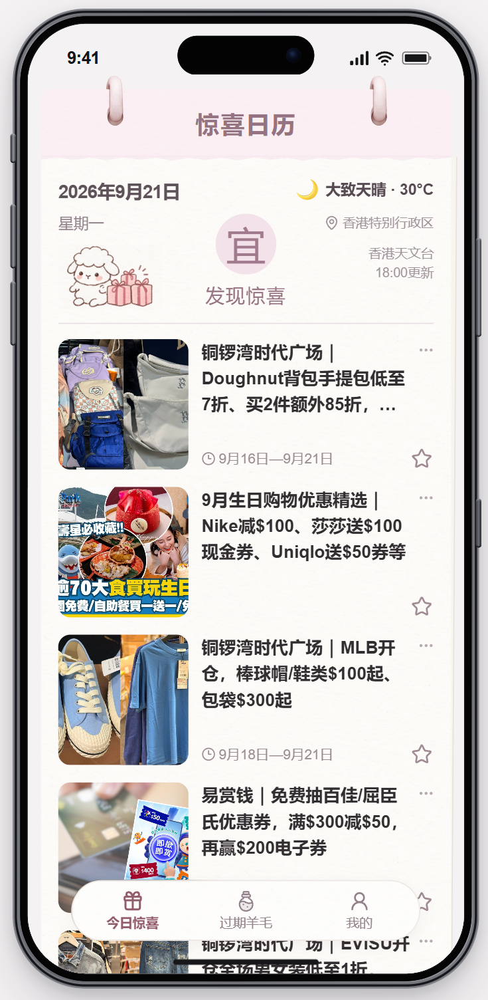
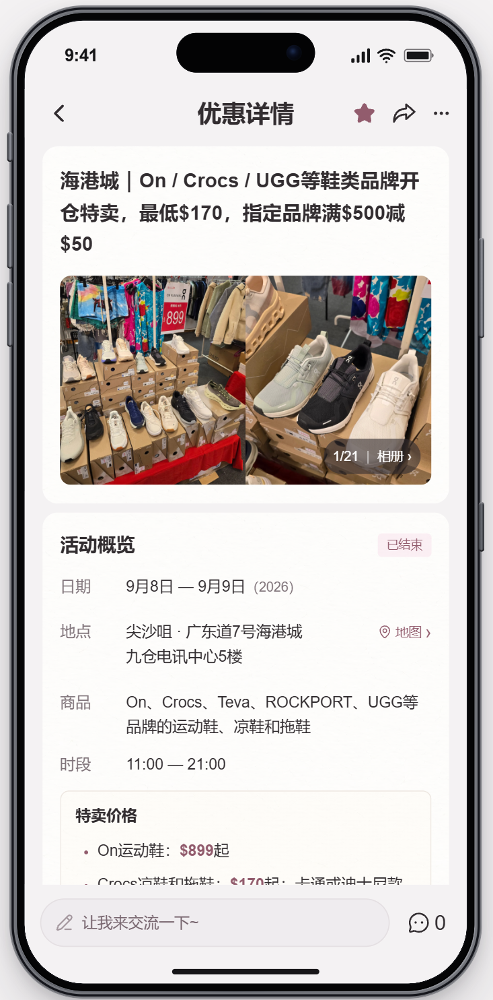
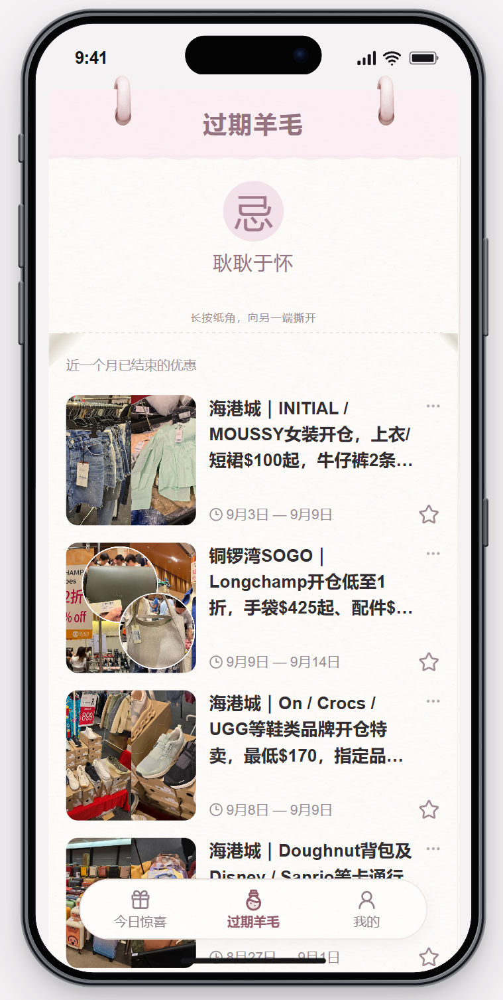

# 忽然惊喜 · WowInStore

**面向有香港线下购物需求、希望寻找优惠的内地女性用户的优惠发现与到店决策工具。**

把分散的香港购物资讯，整理成用户能快速判断「买什么、便宜多少、有什么条件、何时去、去哪里」的手机页面。

[在线体验（手机端）](https://wowinstore.cn) · [产品设计](docs/product.md) · [AI 数据流程](docs/data-pipeline.md) · [关键迭代](docs/iteration-cases.md) · [演示视频](assets/discovery-demo.mp4)

> 个人主导的已上线 MVP / AI 辅助开发。本仓库是求职展示材料，不是生产服务备份。素材展示的是录制时版本，优惠日期与现网内容会变化。

  
  
  

## 为什么做

优惠资讯并不稀缺，但发现有效活动、从长文中找齐参与条件，以及判断是否值得专程到店，仍然需要用户自己完成信息整合。本项目聚焦这条具体路径，而不是搭建交易平台或泛化导购社区。

## 我的工作

独立发起并主导产品，从问题定义、竞品体验、信息架构和交互设计，到 AI 内容工作流、验收与上线。通过自然语言提出需求、校正规则和定义验收标准，借助 AI 编程工具完成代码实现与调试；不将 AI 辅助实现表述为全部独立手写。

重点决策包括：列表与详情的信息分层、优惠条件不可丢失、事实与展示策略分离、异常内容可追溯，以及人工审核与发布闭环。详见 [个人职责与 AI 协作](docs/ai-collaboration.md)。

## 核心设计｜让优惠更好发现、更容易判断

围绕「发现优惠 → 看懂优惠 → 判断是否值得到店」，用「今日惊喜」集中呈现仍在进行的优惠，通过封面、标题和活动日期帮助用户快速浏览；进入优惠详情页后，再结构化呈现商品范围、优惠力度、参与条件、活动时间和地点。活动相册、门店地图及与活动关联的交流入口，进一步支持到店判断。已结束的活动进入「过期羊毛」，与当前有效优惠分开呈现。

## 情绪体验｜让发现有期待，让错过也轻松

通过日历式布局、柔和色调和「宜·发现惊喜」的日常仪式感，希望让浏览优惠成为看看「今天有什么值得期待的小事」。「过期羊毛」用轻松自嘲的语气安放错过优惠的小遗憾，情报交流区为分享发现、互相提醒留出空间。这些是设计意图，尚不代表已经通过用户研究验证的情绪收益。

## 不只是界面：内容如何持续进入产品

U Lifestyle 四个指定栏目 → 程序抓取与版本去重 → Kimi K2.6 评估与候选图片选择 → 程序下载校验 → Kimi K3 结构化成稿 → 校验、审核与发布 → 香港到杭州同步 → 手机读取。

模型不直接操作数据库。每一步由程序保存来源和结果；字段、证据、媒体文件与发布状态分别检查。完整分工与实现边界见 [数据流程](docs/data-pipeline.md)。

## 三个值得展开的案例

| 问题 | 决策 | 可查阅材料 |
| --- | --- | --- |
| 没有结束日的活动一直显示为进行中 | 用一个自然月作为展示窗口，但不伪造商家结束日期 | [日期归档案例](docs/iteration-cases.md#案例一无结束日不等于永远进行中)及[源码示例](examples/offer-display-expiry.ts) |
| 有疑点的内容需要人工处理 | 验收待审产生、真实收件、批准、同步展示与撤回 | [审核闭环案例](docs/iteration-cases.md#案例二有待审状态还不等于有审核闭环) |
| 同一份用户状态在多个页面不一致 | 收藏、评论与点赞统一使用本地状态，不让页面各自维护一套 | [一致性案例](docs/iteration-cases.md#案例三把功能做出来不等于把交互做完整) |

## 当前边界

- 已有真实内容处理、数据库、公开只读 API 与私密审核流程。
- 收藏、个人资料、评论、点赞及用户反馈主要是浏览器本地 Demo 交互，不代表成熟账号、多用户社区或反馈工单系统。
- 不提供实时库存，不保证最低价或到店一定有货。
- 暂未提供经过验证的用户规模、转化率、GMV 或效率提升数据。
- 代码中仍有历史筛选分支与最新治理目标不一致的部分，详见[限制与下一步](docs/limitations.md)。

## 阅读路线

- **快速了解产品**：本页 → [产品设计](docs/product.md) → 在线体验。
- **深入看 AI 产品判断**：[数据流程](docs/data-pipeline.md) → [迭代案例](docs/iteration-cases.md) → [协作方式](docs/ai-collaboration.md)。
- **核对材料来源**：[来源与版本说明](docs/sources.md)。

截图、演示中的品牌、第三方图片和来源内容不属于本项目原创资产；请勿将它们作为素材库再次分发。见 [素材与使用说明](NOTICE.md)。
