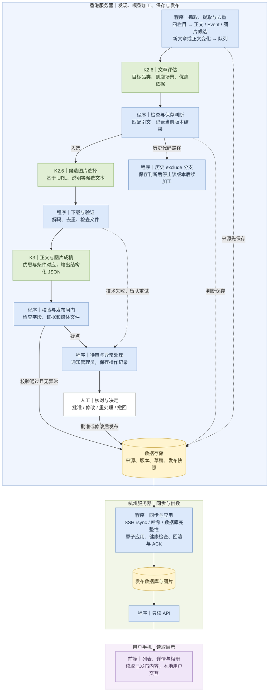

# 从购物资讯到可行动的优惠信息

重点不是让模型写一篇摘要，而是让每条价格与它的商品、条件、日期和地点对应起来。

## 流程与分工

蓝色表示程序，绿色表示模型任务，黄色表示存储，紫色表示前端。香港框内的模型节点表示香港发起官方 API 调用，不代表模型部署在本机。

这是主流程示意，非完整状态机。历史 exclude 分支与最新「模型仅建议、异常转待审」目标仍有差异；不能宣称全部候选已进入人工审核。本次整理没有改动采集逻辑。

## 程序与模型的边界

- 程序读取来源或数据库、组装模型请求，再验证回答并参数化写库。模型不自行访问数据库或执行 SQL。
- 增量判断关注规范化的标题、正文和 Event 活动事实；时间戳、空白排版等变化不应触发重做。
- K2.6 的候选图片选择基于候选文本信息，不表述为逐像素 VLM 图片审核；当前代码固定采用文章原始顶部封面。
- K3 接收正文及实际提供的图片像素，生成结构化内容与证据；正例教表达，不作为新优惠的事实来源。
- 入库贯穿来源、版本、模型结果和草稿阶段，而非最后一步才发生。
- 用户访问页面时读取发布数据，不实时调用模型。

## 提示词中的产品判断

1. **最小单位是带条件的优惠**：不能只保留「送券」，丢掉会员、消费金额或使用门槛。
2. **压缩重复，不压缩事实**：单品牌上下文可省重复品牌名，多品牌活动必须明确对应关系。
3. **精选不能冒充全部**：长清单允许精选，但需在分组文案明确范围。
4. **输出要支持行动**：多门店分行、子优惠分别标注日期，而不是只输出一段流畅摘要。
5. **改写与证据分离**：展示可转简体，引文保留原貌；冲突进入疑点，不由模型凭空裁定。

## 验证与剩余问题

2026-09-21 的验收记录证明审核通知、人工批准、同步展示及撤回曾在正式环境完成。较早技术文档中「提醒尚未上线」的描述不能作为当前结论。与此同时，当前本地源码仍保留 exclude 后停止加工的分支，需单独收敛；两件事不可混为一谈。

完整生产数据、邮箱配置、服务器地址和审核入口不放入本公开仓库。
